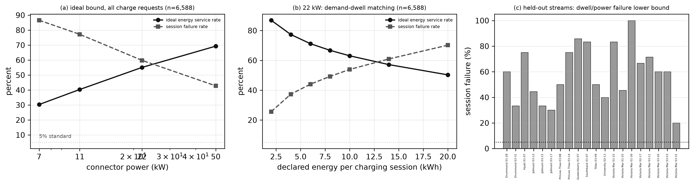

# Electrification Tipping Point

Research code and selected results for a parking-site charging-provision study: **how many
charging berths should a public parking site operate when the arriving fleet mixes electric and
combustion vehicles and dwell time is the scarce resource?**

The study replays observed Melbourne parking events, adds a declared electric-vehicle scenario,
and compares service rules, ideal delivery bounds and conditional configurations. It is a
research repository, not a deployed service.

## Status (2026-10-31)

- Working draft under internal review. **Not submitted, not accepted, no preprint, no DOI.**
  Nothing here is a claim of journal acceptance.
- Scope: one city-year (Melbourne 2014), ten sites, 185,550 observed events reconstructed from
  the open archive. Single city-year evidence; no generalisation claim beyond these sites.
- EV presence, charging willingness and requested energy are **declared scenario fields**
  generated by the code, not observations: the source records parked vehicles only.
- The Taipei/collection module used in earlier versions has been retired and is not part of the
  running code.

## A representative result



Analytic upper bound of deliverable energy against connector power, for independent and
dwell-coupled demand mechanisms. These are bounds with perfect scheduling assumed, not an
executable policy; see [docs/method.md](docs/method.md) equations (1)-(3). Higher power does
not close the gap because dwell, not connector count, is the binding constraint in these sites.

## Quick start

```
python -m venv .venv
.venv\Scripts\activate            # Windows; use source .venv/bin/activate on POSIX
pip install -r requirements.txt
python analysis/example.py         # 300-row sample -> bound table + figure
python scripts/check_public.py     # links, path hygiene, sample, figures, syntax
python -m unittest discover -s apps/parking_lab/workbench/tests -p "test_*.py"
```

No network access is needed for the quick start; the sample rows are included. MATLAB is
optional: [matlab/prei](matlab/prei) is a separate reference implementation and is not required.

## Data

Source: City of Melbourne, *Parking bay arrivals and departures 2014*, dataset `mq3i-cbxd`,
licensed **CC BY 4.0** —
https://data.melbourne.vic.gov.au/explore/dataset/parking-bay-arrivals-and-departures-2014/

The raw archive (236 MB, 13.5M rows) is **not** stored here. Acquisition, checksum
verification, filtering rules and the retained `InViolation` flag are documented in
[docs/data.md](docs/data.md). A 300-row adopted sample is included at
[data/sample/parking_events_sample.csv](data/sample/parking_events_sample.csv) so the example
runs without the download.

## Reproducibility

| layer | entry point |
|---|---|
| declarative demand generation and replay engine | [apps/parking_lab/workbench](apps/parking_lab/workbench) |
| reference PREI experiments (fixtures, configs, recorded runs) | [experiments/prei](experiments/prei) |
| optional MATLAB reference implementation | [matlab/prei](matlab/prei) |
| public checks | [scripts/check_public.py](scripts/check_public.py) |
| full-data steps and known gaps | [docs/reproduce.md](docs/reproduce.md) |
| selected machine outputs | [results/README.md](results/README.md) |

## Repository layout

| path | purpose |
|---|---|
| `apps/` | simulation, rules, allocation, demand scenario, metrics, tests |
| `experiments/` | PREI reference configurations, fixtures and recorded runs |
| `matlab/` | optional MATLAB reference implementation |
| `analysis/` | public runnable example |
| `results/` | selected figures and machine outputs cited by the paper |
| `data/` | source, licence and the 300-row sample |
| `docs/` | method, data and reproduction notes |
| `manuscript/` | the single public manuscript entry (status only; no draft published) |

## Manuscript and citation

The manuscript entry point is [manuscript/README.md](manuscript/README.md). No version of the
paper is published here yet, so there is no citation to give; do not cite this repository as a
published paper. Bibliographic records for the literature the work builds on are in
[references.bib](references.bib).

## Licence

Third-party data: CC BY 4.0, attribution required. Code: no reuse licence granted yet — see
[LICENSE.md](LICENSE.md). Third-party papers are not redistributed.

中文入口：[docs/README.zh.md](docs/README.zh.md)
