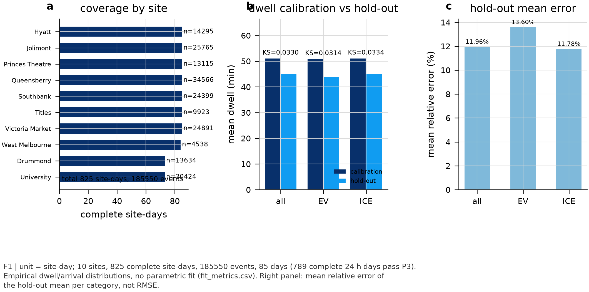
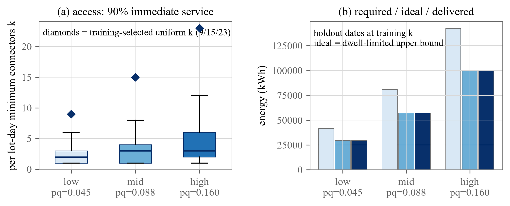
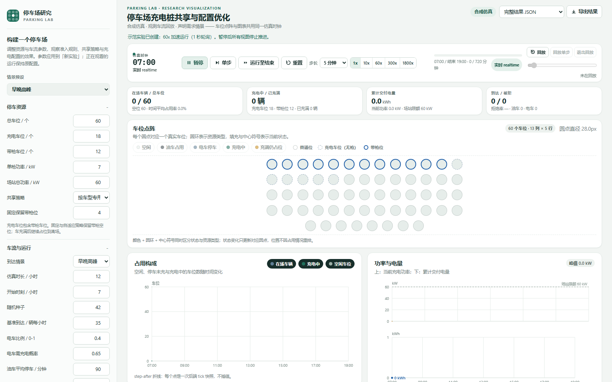

# Electrification Tipping Point

[](https://github.com/wrekkle/Electrification-Tipping-Point/actions/workflows/check.yml)

How many charging berths should a public parking site run? This repository holds the code, the selected outputs and the notes needed to follow a study of that question. Arrivals and dwell times are observed. Whether a parked vehicle is electric, whether it wants a charge and how much energy it asks for are not in the records, so they enter as a declared scenario. The study then compares service rules, computes an analytic bound on deliverable energy, and searches for connector counts that meet a stated service standard.

This is research code, not a deployed service, and not a published paper. Status date: 2026-11-01.

中文入口：[docs/README.zh.md](docs/README.zh.md)

## Two cases, kept separate

| | Melbourne 2014 | Yantai 2025 |
|---|---|---|
| role | historical benchmark; the case the manuscript is built on | current domestic work; checks how far the dwell-limited reading survives on observed domestic lot-days |
| data | 10 sites, 185,550 observed parking events reconstructed from the City of Melbourne open archive; one city-year | 35 lots, 311,589 parking sessions from 2025-03-01 to 2025-05-20; plates masked; raw rows not redistributed |
| model | observed arrivals and dwell, declared EV scenario, replay with parking competition, analytic bounds, connector search | observed lot-days, declared EV scenario, charging-access replay only |
| published outputs | figures F1-F9; bound and metric tables under `results/` | figures D1 and D2 (v2); one aggregate table |
| stage | analysis and internal manuscript revision; working draft not published | single city, 11-week window; v3 in development and its results are not published |

The two cases answer related but different questions, and we do not add them into one estimate. Melbourne has event-level public records, so it can support a replay in which electric and combustion vehicles compete for the same spaces, plus bounds that follow from the observed dwell distribution. Yantai has order-level records from one platform, no berth counts and no licence to redistribute rows, so the domestic work stops at the charging-access submodel. What the domestic case tests is whether the dwell argument survives parking patterns from another city and another decade. Its connector counts depend on the declared demand scenario and are not a recommended berth ratio.

## What is done

- Melbourne data. The 2014 archive (13,503,655 rows, 236 MB) was downloaded and checksum-verified. Ten sites were aggregated from block faces, two rows with unusable timestamps were dropped, leaving 185,550 adopted events over 825 site-day blocks, of which 789 pass the complete 24-hour-day check. Processing rules and counts: [docs/data.md](docs/data.md) and [results/data/site_audit.csv](results/data/site_audit.csv).
- Input calibration. Arrival and dwell distributions are compared between calibration and hold-out splits of site-days, and the KS statistic and hold-out mean error are reported instead of a single fit score ([F1](results/figures/F1.png)). This checks that the replay input is stable across the split. It does not validate the charging scenario.
- Replay engine. Python modules for admission, allocation, service rules, demand generation, metrics, energy ledger and cost ledger, with unit tests that run in CI ([apps/parking_lab/workbench](apps/parking_lab/workbench)).
- Analytic layer. The delivery bound, service rates, failure rates and minimal-connector rule are fixed as equations (1)-(11) in [docs/method.md](docs/method.md) and implemented in the public example ([analysis/example.py](analysis/example.py)).
- Configuration search. Connector grids, feasibility classes and paired policy comparisons on held-out site-days ([F2](results/figures/F2.png), [F3](results/figures/F3.png), [F4](results/figures/F4.png), [F5](results/figures/F5.png), [F8](results/figures/F8.png)).
- Reference implementations. A Python PREI reference path with fixtures, configs and recorded runs ([experiments/prei](experiments/prei)); an optional MATLAB implementation with its own recorded runs ([matlab/prei](matlab/prei)).
- Public example and checks. A 300-row Melbourne sample runs without network access ([data/sample](data/sample)); the repository checks are [scripts/check_public.py](scripts/check_public.py), and the same steps run in [.github/workflows/check.yml](.github/workflows/check.yml).
- Domestic work. Yantai orders were acquired, quality-checked and mapped to the parking-event contract, then replayed under three declared demand scenarios; v2 is the current version ([results/figures/domestic](results/figures/domestic)).



*F1, Melbourne input coverage and dwell calibration.* Panel (a) counts complete site-days per site. Panel (b) compares mean dwell on calibration and hold-out splits. Panel (c) shows the mean relative error of the hold-out mean by category. The unit is a site-day, and panel (c) is not an RMSE. Read this as evidence that the replay input is stable across the split; it says nothing about charging demand.

## Representative results

### 1. Melbourne: what perfect scheduling would allow

| connector power | ideal energy service rate | session failure rate |
|---|---|---|
| 7 kW | 30.3% | 86.6% |
| 11 kW | 40.4% | 77.2% |
| 22 kW | 55.1% | 59.8% |
| 50 kW | 69.3% | 42.8% |

With 6,588 charge requests and 92,366 kWh requested across the ten sites, the bound is the share of requested energy that could be delivered if every connector were free exactly when a charging vehicle needed it. The session failure rate is the share of requests that cannot reach their full target energy inside their own dwell. At 22 kW, 55.1% of requested energy is deliverable and 59.8% of sessions fall short. At 50 kW the two numbers move to 69.3% and 42.8%, still far from full service on this site set. The bound sets a ceiling. It does not describe a policy that reaches it.

*Conditions.* Pooled over the ten sites and all observed site-days at the declared 22 kW hardware. The demand is the declared scenario: EV share 0.10, charge need 0.36 of EVs, energy from a truncated normal (14, 6) kWh on [2, 40], seed 20261031. `InViolation` rows are kept (10.58% of adopted rows); excluding them lowers the 22 kW rate to 50.1%. A post-hoc variant that couples charge demand to dwell gives 70.4% instead of 55.1% ([results/data/demand_coupling_denominators.csv](results/data/demand_coupling_denominators.csv)). That variant was built after the main results, does not identify a charging mechanism, and is reported as a sensitivity. Source files: [results/data/ideal_bound_allsites.csv](results/data/ideal_bound_allsites.csv), [results/data/in_violation_sensitivity.json](results/data/in_violation_sensitivity.json), and [F9](results/figures/F9.png) (three panels; open it at full size).

### 2. Yantai 2025: connector counts on observed lot-days (v2)



*D2 (v2), Yantai 2025 charging-access replay at 22 kW.* Panel (a) gives the minimum connectors per lot-day needed for 90% of charging arrivals to be served immediately; the diamonds mark the single city-wide count chosen on the training dates. Panel (b) compares required, dwell-limited ideal and delivered energy on the held-out dates at that count. The left panel is scenario demand, not observed charging. The right panel is limited by dwell and connector power, not by connector queueing.

The three declared scenarios put 14,128 / 27,496 / 49,734 charge requests into the 311,589 observed sessions (p_EV x q_need = 0.15 x 0.30, 0.25 x 0.35, 0.40 x 0.40). Under a standard of 90% immediate service, the per-lot-day minimum connector count has median 2 / 3 / 3, with 90th percentile 4 / 6 / 9 and maximum 9 / 15 / 23. If each lot runs its own count chosen on the training dates (111 / 172 / 258 connectors in total), the 16 held-out dates serve 98.3 / 98.3 / 99.4% of charging arrivals immediately, with failures at 0.29 / 0.56 / 0.35%. Delivered energy is 70.6 / 70.4 / 70.1% of requested, against a dwell-limited ideal of 70.8 / 70.8 / 70.2%, a gap of at most 0.4 percentage points. A single city-wide count of 9 / 15 / 23 takes each lot's training maximum, serves 100% of held-out arrivals immediately and delivers the full dwell-limited ideal; the figure's right panel shows that conservative case.

What this supports: in this model, the queue at the connectors is not what limits delivery. The product of dwell and connector power is. What it does not support: any claim about actual EV behaviour, about parking competition, or about other cities. The numbers come from one platform, one city and an 11-week window, and the demand scenarios are assumptions.

*Conditions.* 22 kW connectors; lognormal energy target with median 12 kWh, clipped to 3-60 kWh; 35 training and 16 held-out dates; 35 lots. Including stays longer than 24 hours as a sensitivity moves the city-wide count to 10 / 22 / 24 and the energy rate to about 72-73%. Under a 5% session-failure standard instead of 90% immediate service, the same replay asks for 2 / 3 / 5 connectors but leaves 22-24% of requests waiting or failed; the 90% standard is the one reported. The observed coverage and dwell behind these lot-days are plotted in [D1](results/figures/domestic/D1_coverage_dwell.png). Source: [results/data/domestic_scenario_replay_v2.csv](results/data/domestic_scenario_replay_v2.csv).

*Version.* v2 replaced v1 after an energy-unit mismatch, a connector-release bug, whole-city aggregation and failed requests dropped from the denominator were found. The v1 figure reported 9 / 13 / 22 connectors and a near-zero waited share; those numbers are withdrawn and the file is kept as history ([D2_scenario_replay.png](results/figures/domestic/D2_scenario_replay.png)). A v3 revision is in development and none of its results are published.

## Three model layers, not interchangeable

- **Parking competition and replay** ([apps/parking_lab/workbench](apps/parking_lab/workbench)). Observed arrivals enter with rules A-D; admission and allocation decide which vehicle gets a space or a connector. This layer models electric and combustion vehicles competing for the same site and produces model results, not observations.
- **Charging-access submodel** (domestic v2). Observed sessions are sampled into charge requests at rate p_EV x q_need, queue at connectors, and lose service at departure. This layer has no parking competition and no site capacity, so its connector count is a scenario-based access requirement rather than the berth count of a lot.
- **Ideal energy upper bound.** Deliverable energy is min(f x E, P x T / 60) with perfect scheduling. It ignores connector count by construction and carries no policy.

A bound answers what is reachable. A replay answers what a rule did on held-out site-days. The access submodel answers how many connectors a stated demand scenario would need. None of the three can stand in for another.

## Data, assumptions and what stays local

| layer | examples | where |
|---|---|---|
| observed | arrival and departure timestamps, dwell, bay, street, `InViolation` (Melbourne); lot identifier, entry and exit time (Yantai) | [data/](data/) |
| declared scenario | `is_ev`, `needs_charge`, requested energy, EV share, charge need, p_EV x q_need, energy distribution | [docs/data.md](docs/data.md) |
| model output | connector counts, delivered energy, failure rates, bounds | [results/](results/) |

The data cannot identify how many parked vehicles were electric or how many wanted a charge, and no field records an EV. The scenario layer is generated by code with a recorded seed. Reading a result as an identified EV behaviour would be wrong.

The Melbourne archive stays with the publisher under CC BY 4.0; a 300-row adopted sample is included so the example runs. The Yantai raw rows, page snapshots and plate tokens stay local under the platform terms. The site-to-block-face selection list for Melbourne, the figure pipeline and the domestic replay code are also not published. The consequence is recorded in [docs/reproduce.md](docs/reproduce.md): the processed Melbourne contract and every number in the domestic replay cannot be rebuilt from this repository alone. What can be checked here is the aggregate table, the figures, and the code path that produced the bounds.

## Quick start

```
python -m venv .venv
.venv\Scripts\activate          # Windows; on POSIX use: source .venv/bin/activate
pip install -r requirements.txt
python analysis/example.py        # 300-row sample -> bound table, JSON and PNG
python scripts/check_public.py    # links, path hygiene, sample, figures, syntax
python -m unittest discover -s apps/parking_lab/workbench/tests -p "test_*.py"
```

The example writes `results/sample_bounds.json` and `results/sample_bounds.png` and prints the four power rows. The checks print one PASS line per contract and exit 0. No network and no MATLAB are needed; the MATLAB folder is optional.

Scope of the quick start: it runs the bound from [docs/method.md](docs/method.md) equations (1)-(3) on 300 adopted Melbourne rows. It is a smoke test. It does not reproduce any figure under `results/figures` and it does not touch the domestic replay.

## Web frontend (demo)

`apps/parking_lab` also ships a local research-visualisation frontend. It drives the synthetic simulation from a browser: a scenario panel, one shared simulation clock, a bay matrix with a legend for occupancy and charging state, occupancy and power/energy charts, and an export of the run. It is a way to operate and inspect the simulation. It does not display the Melbourne or Yantai study results, and the numbers on the screen come from the preset scenario you choose.



*The lab at 1600 x 1000 on the synthetic early-peak preset: scenario setup on the left, shared clock and frame controls, bay matrix in the middle, occupancy and power/energy charts below. Open the image for full size.*

The shortest way to see it:

1. On the GitHub page choose **Code > Download ZIP** and unzip it (a clone works too).
2. Install Python 3.10 or newer from python.org, and tick "Add python.exe to PATH" during setup.
3. Windows: double-click `apps\parking_lab\start_lab.cmd`. macOS or Linux: open a terminal in the repository root and run `python3 -m apps.parking_lab.workbench serve --port 8765`.
4. Open http://127.0.0.1:8765/ in a browser; the page shows the running synthetic lab.

No packages beyond the Python standard library are needed, and the server only listens on 127.0.0.1. If the port is busy, pass another one, for example `--port 8766`. Frontend unit tests run with `node --test apps/parking_lab/workbench/web/tests/dotgrid.test.mjs`; the Python side is covered by the workbench tests above. The layout was checked at 390 px as well as desktop width, and the narrow view folds the parameter panel behind a button.


## Where to look

| path | what is there |
|---|---|
| [docs/method.md](docs/method.md) | symbols, units and equations (1)-(11) |
| [docs/data.md](docs/data.md) | sources, processing rules, what is observed and what is declared |
| [docs/reproduce.md](docs/reproduce.md) | what can be rebuilt here and what cannot |
| [results/README.md](results/README.md) | what each published figure and table is |
| [apps/parking_lab](apps/parking_lab) | replay engine, rules, metrics and tests |
| [experiments/prei](experiments/prei), [matlab/prei](matlab/prei) | reference implementations with recorded runs |
| [data/](data/) | source, licence and the 300-row sample |
| [docs/README.zh.md](docs/README.zh.md) | Chinese entry with the same facts |

## Manuscript and licence

The manuscript entry point is [manuscript/README.md](manuscript/README.md). There is no published version: no preprint, no DOI, no acceptance record, and the current round has not been submitted. The 2026-03 frozen manuscript and the working draft stay in the authors' local workspace. Do not cite this repository as a published paper. Bibliographic records for the literature the work builds on are in [references.bib](references.bib).

Third-party data stay under their publisher's licence: the Melbourne extract is CC BY 4.0 with attribution to the City of Melbourne. No licence has been chosen for the code yet, so it is provided for reading and review without a grant of reuse rights; see [LICENSE.md](LICENSE.md). Third-party papers are not redistributed.
