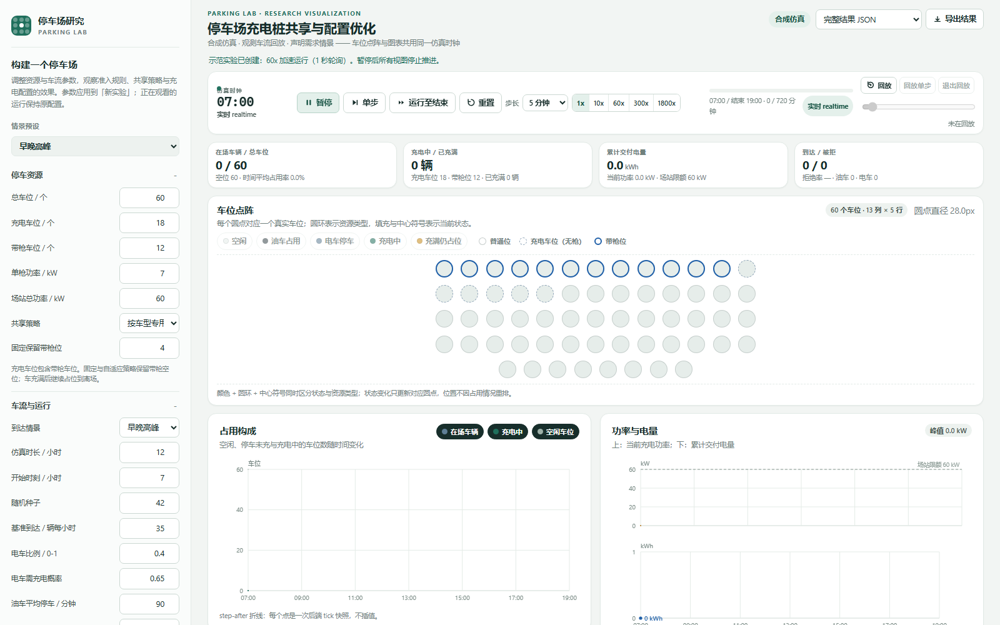

# 停车场仿真与在线学习实验台

类型: 说明
状态: 生效
负责人: tho25
日期: 2026-10-30

可运行的合成实验工具：配置停车资源与需求，观察在线预测，并重放相同车流比较共享策略。实现位于 `workbench/`，独立于冻结稿件与原有 Python/Octave 实验；任务登记在项目内部记录（未公开）。

## 启动与使用

在项目根目录运行（Python 3.10及以上，仅使用标准库）：

```text
python -m apps.parking_lab.workbench serve --port 8765
```

打开 [本地界面](http://127.0.0.1:8765/)。也可双击 [start_lab.cmd](start_lab.cmd)，在其窗口按Ctrl+C停止。端口被占用时用 `--port 8766`。

选择预设或修改参数，点击“应用参数并重置”，再开始、暂停、单步或运行至结束。宽窗显示侧栏；窄窗通过“展开参数设置”编辑。策略比较使用当前表单参数，界面会显示实际比较的规模。配置、结果、车辆/事件/预测账本均可下载。

六种预设包含稳定到达、高峰、突发、中途变化、小型场地及纯停车；总车位、充电位、带枪位、功率、停车时长、充电需求、随机种子、先验与成本均可调整。总车位/枪数/需求为零、全油车/全电车均有边界支持；须满足枪数≤充电位≤总车位。

## 界面预览



1600×1000，合成早晚高峰预设；窄屏 390 px 下侧栏折叠为“展开参数设置”，页面无横向溢出。

## 批量运行

```text
python -m apps.parking_lab.workbench run --config apps/parking_lab/configs/example.json --out tmp/my-parking-run
python -m apps.parking_lab.workbench compare --config apps/parking_lab/configs/example.json --seeds 42,43,44 --out tmp/my-parking-compare
python -m unittest discover -s apps/parking_lab/workbench/tests -v
```

输出目录必须尚不存在，防止覆盖；不传 `--out` 只打印JSON。完整结果包含配置、种子、外生车辆流摘要、版本、源码SHA-256、车辆与预测评分。比较按种子配对重放，报告均值与样本标准差；标准差不等于置信区间。

## 模型口径

- 车流是1分钟分段恒定的泊松过程，车型、服务与到达使用分离随机流。停车时长为有界截断的对数正态抽样，能量为有界截断的Gamma抽样，因此极端参数下截断后的实际均值可能偏离输入均值。
- 入口观察所有到达的油电类型和充电意愿，包括被拒车辆。电车与需充电电车分别计数；现有余位快照不能直接充当这些逐车标签。
- 固定枪位：前C个充电车位有枪，C至B之间仅为充电预留位。无排队、挪车或插枪切换。无枪电车可停车，但不会交付电量。充满释放功率，车位与枪位仍保留到离场；并发任务均分馈线功率，各枪受额定功率上限约束。
- 严格分区只允许需充电车进充电位、仅停车车辆进普通位。其余策略优先普通位，固定/自适应保留带枪空位。自适应使用历史估计的短期充电到达数加平方根安全余量，是启发式基线，无最优性保证。
- 学习器采用折扣Gamma–Poisson及Beta–Bernoulli，先验独立于车流真值；先预测再更新。当前预测计入无车到达的暴露时间，评分针对上一到达时刻发布的预测。末尾右删失不伪造新到达。时变情景中的预测区间无覆盖保证，界面提供实测覆盖与宽度。
- 能量账分为交付、拒绝、离场缺口、在场待交付。充电完成率分母为所有需充电到达，含被拒及窗口末仍在场请求，不能当作最终会话成功率。
- 成本口径 v2（`v2-2026-10-30`，唯一来源为项目内部《成本模型 v2》文档，未公开）：分项为用户时间、额外能耗、外部影响、剩余行程损失（电车）与搜索/绕行/步行时间、车辆运行、外部影响、活动损失（油车），加运营折旧、购电、维护。投诉处理成本已删除；旧 v1 结果保留字段并标 `v1-legacy`，不混读。
- 缺参一律 null：任一必需参数缺失则该项 null、`complete=false`、总成本显示"无法完整计算"，同时给出可计算分项与 `missing_parameters`；不得以 0 代参。占桩影响 `occupancy_impact` 只作反事实归因展示，不进 total；停车费/充电费/罚金/补贴属转移支付，另列。
- 占桩反事实用配对运行（允许占位 vs 及时释放），两侧复用同一外生流并比对 `traffic_hash`；哈希不等即拒绝出差值。

## 接口与限制

GET：`/api/health`、`/api/presets`、`/api/state?id=...`、`/api/export?id=...&format=json|csv|events_csv|predictions_csv|ledger_csv|cost_csv`。

POST：`/api/validate`、`/api/create`、`/api/step`、`/api/run`、`/api/reset`、`/api/close`、`/api/compare`、`/api/advance`（后端推进时钟）、`/api/mode`、`/api/speed`、`/api/pause`、`/api/resume`、`/api/replay/start|step|exit`。错误以JSON返回。

## 持续运行与真实数据

- 持续仿真由后端推进时钟：`realtime`（1 仿真分钟=60 实时秒）、`accelerated`（倍速）、`paused`、恢复后从当前时刻继续、`replay`（固定轨迹回放，界面显式标注"回放"）。事件单调递增并带已入账水位守卫，暂停期间不推进、恢复不重复入账；不靠重置 seed 或数组索引重播。
- 外部数据只经通用公开数据事件契约进入（`publicdata` 适配层，round8 起）；台北专属采集与回放链路已于 2026-10-31 退出运行程序，历史批次只读留档，不再被本程序读取。


仅监听127.0.0.1；会话保存在内存，最多6个，闲置1小时后可在新建时清理。刷新页面创建新会话；服务重启需导入配置重新运行，不直接从结果JSON续训。最多2000车位、72小时、40000实际到达；大场地只画前300格，统计与导出保留全量。多种子比较另有总运行量上限。

这是可用的在线学习基线与仿真平台，round8 起由公开停车事件契约驱动，未用台北快照或旧拟合参数校准，不代表真实预测准确率、政策效果或装桩最优比例；MATLAB事件层与神经网络均未实现。
