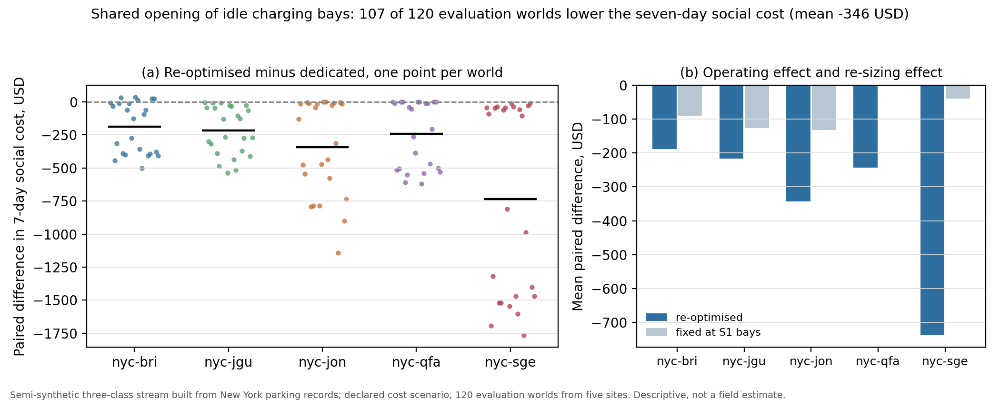

# 中文入口

状态: 生效
日期: 2026-11-04

**研究问题.** 停车场总车位固定时，该把多少个车位改成充电位、什么时候把空闲充电位开放给不需要充电的车、以及什么时候值得买移动充电设备？

本仓库是这一研究的公开代码、派生汇总表与图表。它是研究代码，不是上线服务，也不是已发表论文。

English entry: [README.md](../README.md)



*图：共享开放（S2）相对专用充电位（S1）的七日社会成本配对差，每个点是一个评价世界（左）；同一规则下固定车位数（运营效应）与重选配置后的差异（右）。数据：纽约五个停车场站点、三个时间块、两个声明成本情景、120 个评价世界，车辆流为半合成三分类。成本是声明情景，不是校准后的社会成本；图是描述性证据，不是现场估计。*

## 三条结果

1. **重选配置与开放规则相互作用。** 在共享开放规则下重选充电车位数，使 120 个评价世界中的 107 个七日社会成本下降，配对均值 345.56 USD（世界级朴素标准误 40.43）。把车位数固定在专用方案的选择值、只打开规则，均值为 77.66 USD。两者之差是重选配置的响应，且两栏都在从未参与选择的世界计算。
2. **声明成本下移动服务被支配。** 中心成本向量下 k_mob = 0.289 USD/kWh，前提成立时移动服务成本下界为正，任何 m > 0 都被 m = 0 严格支配；只有 4 个边界格（更低电价）能让移动服务获益 1.65–40.47 USD/三日窗。该界是必要条件，不是决策规则。
3. **证据是配对证据，不是现场估计。** 选择用 80 个世界，评价用同一五站点的另外 120 个世界，因此差异描述的是跨时间块与跨声明情景的迁移。车辆流是半合成的：到达与停留是观测的，电动/燃油标签与充电需求是声明情景。

## 最短运行

```bash
python -m pip install -r requirements.txt
python analysis/example.py
python scripts/check_public.py
python apps/parking_lab/workbench/make_summary_figure.py   # 重建上图
```

上图由 [data/t5_summary/paired_worlds_2026-11-04.csv](../data/t5_summary/paired_worlds_2026-11-04.csv) 重建，列定义见 [data/t5_summary/README.md](../data/t5_summary/README.md)。回放引擎与测试在 [apps/parking_lab/workbench](../apps/parking_lab/workbench)。

## 去哪里看

| 路径 | 内容 |
|---|---|
| [docs/method.md](method.md) | 符号、单位与公式 |
| [docs/data.md](data.md) | 数据来源、清洗规则、哪些是观测哪些是声明 |
| [experiments/prei/CASES.md](../experiments/prei/CASES.md) | 两个案例（墨尔本 2014、烟台 2025）的详细材料 |
| [docs/reproduce.md](reproduce.md) | 仓库内可重建与不可重建的内容 |
| [results/README.md](../results/README.md) | 每张公开图表是什么 |
| [apps/parking_lab](../apps/parking_lab) | 回放引擎、规则、指标与测试 |
| [data/](../data/) | 数据来源、许可与 300 行样例 |
| [README.md](../README.md) | 英文入口，事实与本文一致 |

## 范围与许可

两个案例分开报告、从不合并成一个估计，详见 [experiments/prei/CASES.md](../experiments/prei/CASES.md)。第三方数据遵循原发布方许可：墨尔本数据为 CC BY 4.0，需注明 City of Melbourne。代码尚未选择许可，仅供阅读与审阅，不授予复用权，见 [LICENSE.md](../LICENSE.md)。第三方论文不再分发。

稿件在作者工作区，尚未投稿或发表，没有预印本与 DOI。请勿把本仓库当作已发表论文引用。
